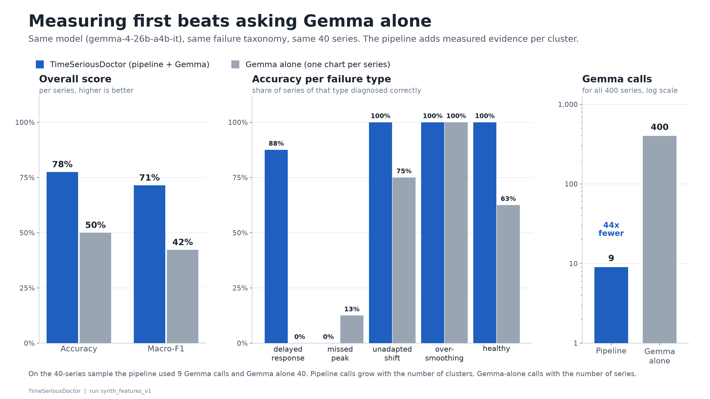
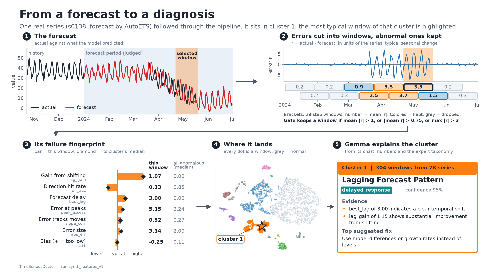

# TimeSeriousDoctor

> Find the recurring ways forecasts fail across thousands of time series, group them automatically,
> and have Gemma 4 explain each failure pattern like a forecasting expert would.

## What it is and who it is for

For forecasting and data-science teams who run hundreds to thousands of forecasts. Aggregate metrics
(MAE, RMSE, MASE) say *how much* a model is wrong, not *how*. Lagging behind changes, missing peaks,
ignoring level shifts and over-smoothing are usually found by experts eyeballing plots, and that doesn't
scale.

TimeSeriousDoctor takes actuals and predictions for many series and:

1. computes scaled residuals;
2. keeps only the windows where the error is abnormal;
3. describes each window with expert failure features (and optionally MOMENT embeddings);
4. clusters the windows into recurring failure patterns;
5. asks **Gemma 4** to diagnose each cluster from a chart panel plus its numbers: what happens, likely causes, what to try, and which metric to monitor.

Everything is shown in a Streamlit "atlas". **Code measures, Gemma explains**: every number comes from
code, and Gemma only interprets the numbers and charts it is given.

> SPEC.md calls this project "Residual Atlas" (the Python package is named `atlas`).

## How to run it

Windows:

```
py -3.11 -m venv .venv
.venv\Scripts\activate
pip install -r requirements.txt
copy .env.example .env
```

POSIX:

```
python3.11 -m venv .venv
source .venv/bin/activate
pip install -r requirements.txt
cp .env.example .env
```

Set `GEMMA4_API_KEY` in `.env` (`GEMINI_API_KEY` also works). Then:

```
pytest                                    # tests, no network
python scripts/smoke_gemini.py            # optional: check your key against the Gemma 4 API
```

The UI opens straight away on the precomputed demo runs in `runs/` (no API key needed):

```
streamlit run app.py
```

Reproduce everything from scratch:

```
python scripts/make_synthetic.py --n 400 --out data/synthetic          # 400 labeled series, 5 failure types
python scripts/run_atlas.py --data data/synthetic --embedder features --run-name synth_features
python scripts/run_eval.py --runs runs/synth_features --n-baseline 40   # pipeline vs Gemma alone
python scripts/prepare_m5.py --n-items 1000 --out data/m5               # real Walmart M5 data (~5 min)
python scripts/run_atlas.py --data data/m5 --embedder features --run-name m5_features --gate-mode quantile
python scripts/make_figures.py --run runs/synth_features --out docs/figures
```

Every Gemma response is cached under `cache/gemma/`, so re-runs don't call the API again.

## Expertise: what knowledge is built in and where it comes from

- **Failure taxonomy** (`taxonomy.yaml`) has five failure types: delayed response, missed peak, unadapted shift, over-smoothing, healthy noise. Each one has a definition, a numeric signature, likely causes, fixes, and a metric to monitor. Our time-series expert wrote it from forecasting practice and refines it after seeing real clusters. It goes into every Gemma prompt.
- **Handcrafted failure features** (`atlas/features.py`) encode how an expert recognizes each failure: lag cross-correlation, peak excess, variance ratio, sign runs, error trend, directional accuracy.
- **Expert review loop:** in the Cluster tab the expert can Confirm, Reject or Rename each Gemma diagnosis. The verdicts go to `expert_feedback.json`. `run_atlas.py --expert-from runs/<previous run>` then feeds them to Gemma as reference diagnoses on the next run.
- **MASE-style scaling** (Hyndman & Koehler, 2006) puts residuals on a common scale, where 1.0 is about a typical seasonal-naive error. This makes thresholds and clusters comparable across series.

## The model and its license

- **Gemma 4**: `gemma-4-26b-a4b-it` (fallback `gemma-4-31b-it`), called through the **Gemini API** with the `google-genai` SDK. Gemma 4 is released as open weights under [Apache 2.0](https://opensource.googleblog.com/2026/03/gemma-4-expanding-the-gemmaverse-with-apache-20.html), and API use is subject to the [Gemini API Terms of Service](https://ai.google.dev/gemini-api/terms). The integration lives in `atlas/gemma.py` and `atlas/prompts.py`: multimodal chart + numbers in, schema-validated JSON out, with disk cache and throttling.
- **MOMENT-1** (optional encoder): [AutonLab/MOMENT-1-small](https://huggingface.co/AutonLab/MOMENT-1-small) on Hugging Face. Its license is on the model card.

## Proof: better than the same model without it

Setup: 400 synthetic series, each with one injected and labeled failure type (or healthy). We take a stratified
sample of 40 series (8 per type) and score both methods on exactly those series. Both use the same Gemma 4 model
(`gemma-4-26b-a4b-it`) and the same expert taxonomy. **Gemma alone** gets one full-series chart per series and is
asked what is wrong. **TimeSeriousDoctor** runs Gemma inside the pipeline: residuals → anomaly gate → failure
features → clusters → one Gemma call per cluster. Output of `scripts/run_eval.py`; no Gemma call failed on either side.

| method | accuracy | macro-F1 | Gemma calls (40-series sample) | Gemma calls (all 400 series) |
|---|---|---|---|---|
| **TimeSeriousDoctor** | **80.0%** | **0.73** | 9 | **9** |
| Gemma alone | 55.0% | 0.46 | 40 | 400 |

| failure type (8 series each) | TimeSeriousDoctor | Gemma alone |
|---|---|---|
| delayed response | **100%** | 0% |
| missed peak | **100%** | 13% |
| unadapted shift | **100%** | 88% |
| over-smoothing | 0% | 100% |
| healthy | **100%** | 75% |

Pipeline quality on the same run:
- Gate F1 is 0.88.
- Clustering scores ARI 0.57, NMI 0.69 and purity 0.85.
- Gemma named 100% of the clusters correctly.
- Series-level accuracy across all 400 series is 82%.

Gemma alone cannot see lag or short spikes on a full chart and labels most series as over-smoothing. The pipeline
measures them explicitly. It also localizes *where* each failure happens, groups series that share a failure, and
needs 44× fewer Gemma calls.

Known limitation: over-smoothing windows share a cluster with missed-peak windows, and that cluster is named
missed peak. That's why the over-smoothing row is 0%.




On real data (M5 / Walmart, 1,000 items × 2 models = 2,000 forecasts), the run finds 8 failure patterns in the
5,500 most abnormal windows. Each pattern is explained by Gemma (`runs/m5_features`).

## More

- Architecture, module ownership and build priorities: see [SPEC.md](SPEC.md). Decisions and verified API facts: see [NOTES.md](NOTES.md).
- Disclaimer: automated diagnostics are suggestions to investigate, not guarantees and not financial advice. Verify before changing production models.
- License: Apache-2.0, see [LICENSE](LICENSE).
