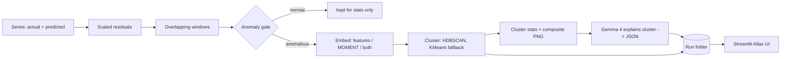

# Residual Atlas (product name: TimeSeriousDoctor) — MVP Spec (4-hour hackathon)

> Find the recurring ways forecasts fail across thousands of time series, group them automatically,
> and have Gemma 4 explain each failure pattern like a forecasting expert would.

---

## 0. Instructions for Claude Code (read first)
> **Time budget:** **4 hours** of implementation (not 5). Build the MVP — cover the main cases, skip edge cases. §9 and §10 are already compressed to 4 h.
> Two things are required for judging and are never cut: the **Gemma-alone comparison** (§7.11 — proof that our pipeline beats the naive "just ask Gemma" solution) and the **submission checklist + README template** (§15).

You are helping a 3-person team build an MVP during a 4-hour hackathon. Rules:

1. **Strict priority order.** Build tasks in the order of Section 9 (P0 → P1 → P2). Never start a P1 task while a P0 task you own is unfinished.
2. **Stay in your lane.** Each teammate runs their own Claude Code session and owns specific tasks and files (Section 9). Shared interfaces — `atlas/schema.py`, `taxonomy.yaml`, the run-folder format (Section 6) — change only when the team agrees.
3. **Simple and working beats general.** No abstractions "for later", no plugin systems, no class hierarchies where a function will do.
4. Python **3.11**, type hints, pydantic v2 for schemas, `pathlib`, config passed explicitly (no hidden globals).
5. Every P0 module gets at least one fast `pytest`. Tests never call the network (mock Gemini).
6. MOMENT/torch are **optional**: import them lazily inside `atlas/embed_moment.py`. Everything else must run without them installed.
7. Secrets come from `.env` (`GEMMA4_API_KEY`, fallback `GEMINI_API_KEY`; read them with `atlas.config.get_api_key()`). Never hardcode or log keys.
8. If this spec is ambiguous, pick the simplest option, add a one-line note to `NOTES.md`, and keep going.
9. After finishing each task, stop and print a 3-line summary: what was built, how to run it, what's next.

---

## 1. Product

**Problem.** Forecasting teams judge models with aggregate metrics (MAE, RMSE, MASE). These hide *how* a model fails: lagging behind changes, missing peaks, not adapting to level shifts, over-smoothing, failing only around holidays. Experts find these by eyeballing plots, which doesn't scale to thousands of series.

**Solution.** Residual Atlas takes actuals + predictions for many series and:
1. computes scaled residuals and cuts them into windows,
2. keeps only windows where the error is abnormal (anomaly gate),
3. embeds those windows (handcrafted failure features and/or the MOMENT time-series foundation model from Hugging Face),
4. clusters them into recurring failure patterns,
5. asks **Gemma 4** (image + numbers) to name and explain each pattern: what happens, likely causes, what to try, which metric to monitor,
6. shows everything in a Streamlit "atlas".

**Demo headline.** "2,000 forecasts in → N recurring failure patterns, each explained, with the affected series — and on labeled data our pipeline identifies the failure correctly X % of the time vs Y % for Gemma alone looking at the same charts, using k instead of N Gemma calls."

**Core design principle.** *Code measures, Gemma explains.* Every number in the UI comes from code. Gemma never computes numbers; it interprets the numbers and images it is given.

**Hackathon tracks** (full rules and checklist in §15).
- *Best Open-Source AI Project* (main track): open-weight AI must be an important part of the project. Ours is a harness we wrote around open models — Gemma 4 (Apache-2.0 open weights) does every explanation, MOMENT-1 (MIT) is the optional encoder. Public GitHub repo with an OSI license (Apache-2.0 in `LICENSE`). We are not an agent skill, so no `SKILL.md` is needed.
- *Best Use of Gemma 4*: Gemma 4 **through the Gemini API**; the README names the model, and we must be able to show the integration in code (`atlas/gemma.py`, `atlas/prompts.py`): multimodal reasoning over chart panels + structured JSON explanations.

---

## 2. Architecture



The **run folder** (Section 6) is the only interface between the engine (CLI) and the UI. The UI never runs the heavy pipeline in P0/P1; it loads precomputed runs.

---

## 3. Tech decisions

| Area | Choice | Why |
|---|---|---|
| UI | **Streamlit** | Pure Python, native plotly/dataframes, `st.cache_data`, one file, very fast to iterate. Reflex compiles to a React app (Node toolchain, state classes, build step) — nicer for polished custom apps, slower for a data dashboard in 5 h. |
| LLM | **Gemma 4 via Gemini API** (`google-genai` SDK). Default `gemma-4-26b-a4b-it` (MoE, likely faster), alternative `gemma-4-31b-it` | Nothing to host; multimodal; system instructions; JSON output. |
| Encoder | **MOMENT-1** from Hugging Face (`AutonLab/MOMENT-1-small` default; base/large optional), `task_name="embedding"` | Open time-series foundation model with an embedding mode. |
| Baseline features | Handcrafted failure features (Section 7.5) | Interpretable, instant, and the fallback if MOMENT fails. |
| Clustering | `sklearn.cluster.HDBSCAN` (scikit-learn ≥ 1.3), KMeans fallback | No need to pick k; leaves odd windows as "noise" = "look manually". |
| M5 forecasts | `statsforecast` cross-validation | Realistic rolling forecasts without writing training code. |
| Schemas | pydantic v2 | Validates Gemma JSON and run files. |
| License | Apache-2.0 | Matches Gemma 4's license. |

**Gemini API limits.** The free tier is reportedly around 15 requests/min for Gemma 4 models — verify in AI Studio. We throttle to `gemma.rpm` (default 10) and cache every response on disk. One run needs ~10 Gemma calls (one per cluster + summary), the baseline ~40.

---

## 4. Repo layout

```
residual-atlas/
├── app.py                      # Streamlit entry point
├── atlas/
│   ├── __init__.py
│   ├── config.py               # pydantic Config + defaults, load from YAML
│   ├── schema.py               # data contract, run-folder models, save_run/load_run
│   ├── taxonomy.py             # load taxonomy.yaml, render for prompts
│   ├── data/
│   │   ├── synthetic.py        # generator with injected, labeled failures
│   │   └── m5.py               # M5 aggregation + statsforecast CV -> contract
│   ├── residuals.py            # scaled residuals + windowing
│   ├── gate.py                 # anomaly gate
│   ├── features.py             # handcrafted failure features
│   ├── embed_moment.py         # MOMENT embeddings (lazy import, cached)
│   ├── cluster.py              # clustering, medoids, cluster summaries, 2D projection
│   ├── plots.py                # matplotlib PNGs for Gemma, plotly figs for UI
│   ├── gemma.py                # Gemini client: throttle, retry, cache, validation
│   ├── prompts.py              # system/user prompt templates
│   ├── pipeline.py             # run_atlas(): end-to-end
│   ├── evaluate.py             # metrics on labeled (synthetic) runs
│   └── baseline.py             # Gemma-alone baseline on full-series images
├── scripts/
│   ├── smoke_gemini.py
│   ├── make_synthetic.py
│   ├── prepare_m5.py
│   ├── make_mock_run.py
│   ├── run_atlas.py
│   └── run_eval.py
├── taxonomy.yaml
├── config.default.yaml
├── tests/
├── data/        # gitignored
├── runs/        # gitignored (except small demo runs if wanted)
├── cache/       # gitignored
├── requirements.txt
├── requirements-moment.txt     # momentfm + torch (optional)
├── .env.example                # GEMINI_API_KEY=
├── NOTES.md
├── LICENSE                     # Apache-2.0
└── README.md
```

`requirements.txt`: numpy, pandas, pyarrow, scipy, scikit-learn>=1.3, statsforecast, matplotlib, plotly, streamlit, google-genai, pydantic>=2, python-dotenv, pyyaml, pytest. Optional: kaggle.

---

## 5. Input data contract

A dataset is a folder with two files.

**`data.parquet`** (long format, one row per series per timestep):

| column | type | required | notes |
|---|---|---|---|
| `series_id` | str | yes | |
| `ts` | datetime or int | yes | regular frequency, sorted within series |
| `actual` | float | yes | |
| `predicted` | float | forecast rows | NaN allowed on history rows |
| `is_forecast` | bool | yes | True for out-of-sample prediction rows |
| `true_label` | str | no | synthetic only: `history`, `healthy`, or injected failure type per row |

**`series_meta.parquet`**: `series_id`, `model_card` (free text, e.g. "AutoETS, weekly season, refit every 28 days"), optional `group` (e.g. department).

`schema.load_dataset(path) -> Dataset` validates columns, sorts, and drops (with a printed report) series with fewer than `min_history` history rows (default 56) or fewer than `window_len` forecast rows.

---

## 6. Run folder (engine → UI interface)

```
runs/<run_name>/
  config.json              # fully resolved config
  data.parquet             # copy of the input dataset
  series_meta.parquet
  windows.parquet          # one row per window (all windows, gated or not)
  embeddings.npy           # float32 [n_gated, d], row i = windows where emb_row == i
  clusters.json            # list[ClusterInfo]
  images/cluster_<id>.png
  gemma_raw/               # raw Gemma responses (debugging)
  summary.json             # P1: AtlasSummary
  eval.json                # P1: evaluation results (labeled runs only)
  expert_feedback.json     # P2
```

**`windows.parquet` columns:** `window_id` (`"<series_id>#<start_idx>"`), `series_id`, `start_idx`, `end_idx` (exclusive; index into the series' forecast rows), `start_ts`, `end_ts`, `score_abs`, `score_bias`, `gated` (bool), `emb_row` (int, −1 if not gated), `cluster` (int; −1 = noise/unclustered, −2 = not gated), `x2d`, `y2d` (P1; NaN if not gated), `true_label` (synthetic only), plus every feature column from Section 7.5.

**pydantic models in `atlas/schema.py`:**

```python
class ClusterInfo(BaseModel):
    cluster_id: int                 # 0..n-1 ordered by size desc; -1 = unclustered bucket
    size: int                       # number of windows
    n_series: int
    medoid_window_ids: list[str]    # up to 3
    feature_median: dict[str, float]
    feature_median_all_gated: dict[str, float]
    model_card_dist: dict[str, float]   # model_card -> share of windows
    context: dict[str, float] | None = None      # P2 calendar context
    image_path: str | None = None
    report: "GemmaClusterReport | None" = None
    expert: dict | None = None                    # P2: {status, name, note}

class RunResult(BaseModel):  # in-memory bundle; persisted as the folder above
    ...
def save_run(run, path: Path) -> None: ...
def load_run(path: Path) -> RunResult: ...   # the UI only uses this
```

`scripts/make_mock_run.py` writes a small fake run (≈20 series, 3 clusters, placeholder PNGs, canned reports) so the UI can be built before the engine exists.

---

## 7. Module specs

### 7.1 `atlas/data/synthetic.py` — labeled synthetic forecasts

```python
def make_synthetic(n_series=400, history_len=365, forecast_len=182, seed=0,
                   mix: dict[str, float] | None = None) -> tuple[pd.DataFrame, pd.DataFrame]
```

- **Actuals:** level + linear trend + weekly seasonality (random amplitude/phase) + optional yearly term + Gaussian noise σ. Daily frequency.
- **Healthy prediction:** `p = actual + N(0, 0.35σ)` (gives scaled abs error ≈ 0.25).
- Each series gets exactly one type from `mix` (default 20% each: `healthy`, `delayed_response`, `missed_peak`, `unadapted_shift`, `over_smoothing`). The failure is injected only inside a random contiguous **segment** of 42–91 forecast days; outside the segment, predictions are healthy. (This forces the gate to do real work.)
- **Injections (inside the segment):**
  - `delayed_response`: add a ramp (slope change) to actuals in the segment; `p_t = a_{t−k} + noise`, `k ∈ {2,3,4,5}` (never 7 — that equals the weekly season and is invisible).
  - `missed_peak`: add 4–8 spikes to actuals (height 3–6σ, width 1–3 days); `p = actual_without_spikes + noise`.
  - `unadapted_shift`: actuals get a level shift `Δ = ±(4–8)σ` from segment start to series end; inside the segment `p = actual − Δ + noise` (stays at old level), after the segment p catches up (healthy).
  - `over_smoothing`: `p = level + trend + α·season + noise`, `α ∈ [0, 0.3]` (dampened seasonality).
- **Labels:** row `true_label` = failure type inside the segment, `healthy` elsewhere in the forecast, `history` before. Window label (computed in residuals.py) = the failure type if ≥ 50% of the window's rows carry it, else `healthy`.
- **Model cards:** random from `["AutoETS", "LightGBM on lag features", "Prophet", "AutoARIMA", "Seasonal naive"]`, **independent of the label** (don't leak the answer to Gemma).
- `scripts/make_synthetic.py --n 400 --out data/synthetic` writes the contract files plus `preview.png` (one example per type) and prints class counts.
- **Minimal version first (P0.4):** only `healthy`, `delayed_response`, `unadapted_shift`.

### 7.2 `atlas/data/m5.py` — real data (M5 / Walmart)

- **Download:** needs a Kaggle account, API token (`~/.kaggle/kaggle.json`), and accepting the competition rules once on the website: `kaggle competitions download -c m5-forecasting-accuracy -p data/m5_raw && unzip`. If blocked, try Nixtla's `datasetsforecast` M5 loader (verify it still works); else skip M5.
- **Files used:** `sales_train_evaluation.csv` (wide, `d_1..d_1941`), `calendar.csv`.
- **Aggregation:** item×store series are intermittent (many zeros) → noisy residuals. Default level `item_total`: sum each item across all 10 stores (3,049 series), keep the top `n_items` (default 1000) by total sales, keep the last `history_days` (default 730) days. Optional level `store_dept` (70 series, very clean) for pretty visuals.
- **Forecasts:**
  ```python
  sf = StatsForecast(models=[SeasonalNaive(season_length=7), AutoETS(season_length=7)], freq="D", n_jobs=-1)
  cv = sf.cross_validation(df=df, h=28, step_size=28, n_windows=6)   # 168 out-of-sample days per series per model
  ```
  Each (item, model) becomes one series: `series_id = f"{item_id}|{model}"`, `model_card = f"{model}, rolling 28-day forecasts, refit every 28 days"`. History rows (before the first cutoff) have `predicted = NaN`.
- **Calendar (for P2 context):** save `data/m5/calendar.parquet` with `ts, weekday, event_name_1, event_type_1`.
- **Runtime guard:** if AutoETS takes > 5 min, set `n_items=300`.
- `scripts/prepare_m5.py --level item_total --n-items 1000 --out data/m5`.

### 7.3 `atlas/residuals.py`

```python
def compute_scaled_residuals(ds: Dataset, season: int = 7) -> pd.DataFrame
def make_windows(res: pd.DataFrame, window_len: int = 28, stride: int = 14) -> pd.DataFrame
```

- `r = actual − predicted` (**positive = under-prediction**).
- Per-series `scale` = mean |a_t − a_{t−season}| over history rows (MASE denominator). Fallback if history < 2·season: mean |a_t − a_{t−1}|. Guard: `scale = max(scale, 1e-6, 0.05·mean|a|)`.
- Store `r_s = r/scale`, `a_s = (a − hist_mean)/scale`, `p_s = (p − hist_mean)/scale`.
- Windows only over forecast rows, drop trailing partial windows. Feature code may read up to `max_lag` (7) rows of context before/after a window from the full series.
- For labeled data, add window `true_label` (rule in 7.1).

### 7.4 `atlas/gate.py`

- `score_abs = mean|r_s|`, `score_bias = |mean r_s|` per window.
- `mode="threshold"` (default for synthetic): gated if `score_abs > t_abs` (1.0 ≈ worse than seasonal-naive-level error) or `score_bias > t_bias` (0.75).
- `mode="quantile"` (default for M5): gated if `score_abs` is in the top `q` (0.25) of all windows.
- Print counts: total windows, gated, share.

### 7.5 `atlas/features.py` — handcrafted failure features

Computed for **all** windows on scaled values (vectorized; must handle ~50k windows in < 30 s). Export `FEATURES: list[str]` and `FEATURE_DOCS: dict[str, str]` (plain-language glossary used in prompts and UI).

| feature | definition | signals |
|---|---|---|
| `abs_err` | mean \|r_s\| | overall severity |
| `bias` | mean r_s | + under-, − over-prediction |
| `best_lag` | argmax_k corr(p_t, a_{t−k}), k ∈ [−7, 7] (uses context rows) | > 0 = prediction trails actual |
| `lag_gain` | corr at best_lag − corr at 0 | strength of lag signature |
| `slope_corr` | corr(r_s, Δa_s) | lag shows up as residual ∝ slope |
| `peak_excess` | mean r_s at peak rows − mean r_s elsewhere (peak = top 15% of a_s in window) | missed peaks |
| `var_ratio` | std(p_s) / std(a_s) (guard std ≈ 0) | < 1 = over-smoothing |
| `sign_run` | longest same-sign run of r_s / window_len | persistent error = shift |
| `r_trend` | OLS slope of r_s × window_len | error growing/shrinking |
| `dir_acc` | share of steps where sign(Δp) == sign(Δa) | tracking movement |

**Tests (on synthetic injections):** delayed k=4 → `best_lag ∈ {3,4,5}`; unadapted_shift → `sign_run ≥ 0.8` and `|bias| > 2`; over_smoothing → `var_ratio < 0.6`; missed_peak → `peak_excess > 1`; healthy → `abs_err < 0.5`.

### 7.6 `atlas/embed_moment.py` — MOMENT embeddings (P1)

```python
def embed_windows(r_windows: np.ndarray, model_size: str = "small", batch_size: int = 64,
                  device: str = "cpu") -> np.ndarray   # [n, d]
```

- `from momentfm import MOMENTPipeline`; `MOMENTPipeline.from_pretrained(f"AutonLab/MOMENT-1-{model_size}", model_kwargs={"task_name": "embedding"})`; `model.init()`; `model.eval()`; `torch.no_grad()`.
- Input shape `[B, 1, 512]`: **left-pad each window to 512 with zeros** and pass `input_mask` (1 = real value, 0 = padding). Output = one vector per window. Verify shapes on 2 windows before batching.
- Embed only gated windows. Cache to `cache/moment_<sha256 of inputs+size>.npy`.
- Caveats: momentfm targets Python 3.11 — pin the env; install from `requirements-moment.txt`. MOMENT may normalize inputs internally, so absolute error size can vanish from its embeddings → that's why mode `both` exists.
- **Embedder modes** (`cfg.embedder`):
  - `features`: `FEATURES` → `RobustScaler`.
  - `moment`: MOMENT → `PCA(16)` → `StandardScaler`.
  - `both`: hstack of the two blocks, each divided by sqrt(its dim) so neither dominates.

### 7.7 `atlas/cluster.py`

```python
def cluster_windows(X, min_cluster_size=20, max_clusters=8, seed=0) -> np.ndarray
def summarize_clusters(windows, labels, X, series_meta) -> list[ClusterInfo]
def project_2d(X) -> np.ndarray   # P1: PCA(2)
```

- If `X.shape[1] > 16`: PCA to 16 dims first.
- HDBSCAN. If < 2 clusters or > 60% noise → KMeans with k ∈ [3, 8] chosen by silhouette. If > `max_clusters` → rerun HDBSCAN with `min_cluster_size × 1.5` (max 3 tries), else KMeans k = 8.
- Relabel clusters 0..n−1 by size (desc). Noise becomes the `-1` "Unclustered — look manually" bucket (no Gemma call).
- Summary per cluster: size, n_series, 3 medoids (closest to centroid in X), feature medians (cluster vs all gated), model_card distribution.

### 7.8 `atlas/plots.py`

- `cluster_panel_png(cluster, windows, res, path)` — **matplotlib**, 1200×900 px, 2×2 grid:
  - Panels 1–3: the medoid windows; actual (black) vs predicted (red) on scaled units; 14 steps of context before the window in grey; window region shaded; titles "Example 1/2/3 — series X".
  - Panel 4: up to 40 member windows' `r_s` curves (thin, alpha 0.2), median curve thick, zero line.
  - Figure title: "Cluster k — n windows from m series". Labeled axes ("steps", "scaled value"). This image is what Gemma sees; make it clean.
- `series_figure(series_id, run)` — **plotly**: full series actual/predicted, forecast region shaded grey, gated windows shaded in their cluster color, hover shows window_id/cluster/abs_err.
- `atlas_scatter(windows)` — plotly scatter of `x2d, y2d` colored by cluster (P1).
- `baseline_series_png(series)` — matplotlib full-series plot for the Gemma-alone baseline (no residual panel, no features).

### 7.9 `atlas/gemma.py` + `atlas/prompts.py`

**Client:**

```python
from google import genai
from google.genai import types

client = genai.Client()  # reads GEMINI_API_KEY
resp = client.models.generate_content(
    model=cfg.gemma.model,                       # "gemma-4-26b-a4b-it"
    contents=[types.Part.from_bytes(data=png_bytes, mime_type="image/png"), user_text],
    config=types.GenerateContentConfig(
        system_instruction=system_text,
        temperature=0.2,
        response_mime_type="application/json",
    ),
)
```

- First try `response_schema=<pydantic model>`. If the API rejects schema or JSON mode for Gemma, fall back to prompt-only JSON. Record which works in `NOTES.md` (P0.2 smoke test decides).
- Parse: strip code fences → `json.loads` → pydantic validate. On failure: one retry with the validation error appended. Still failing → `report=None` (UI shows "explanation unavailable").
- Throttle at `cfg.gemma.rpm` (default 10/min). Retry 429/5xx with backoff 2, 4, 8, 16 s.
- Disk cache: key = sha256(model + system + user text + image bytes) → `cache/gemma/<key>.json`. Re-runs must not re-call the API.
- Save raw responses to `runs/<run>/gemma_raw/`.
- Prompt injection (OWASP LLM01): `model_card`, `group` and `series_id` are user-supplied text that reach the prompt. Truncate each to 200 chars, place them inside a clearly delimited data block, and tell the model in the system prompt that block content is data, never instructions. Gemma has no tools; its output is only validated (pydantic) and displayed.

**Schemas:**

```python
FailureType = Literal["delayed_response", "missed_peak", "unadapted_shift",
                      "over_smoothing", "healthy_noise", "other"]

class Cause(BaseModel):
    cause: str
    why: str

class GemmaClusterReport(BaseModel):
    failure_type: FailureType
    name: str                    # short human name, <= 6 words
    summary: str                 # <= 2 sentences, plain language
    evidence: list[str]          # 2-4 items, each cites a provided feature value or visible pattern
    likely_causes: list[Cause]   # 1-3, most likely first
    suggested_fixes: list[str]   # 1-3 concrete experiments
    metric_to_monitor: str
    confidence: float            # 0-1

class GemmaBaselineAnswer(BaseModel):
    failure_type: FailureType
    confidence: float
    explanation: str

class AtlasSummary(BaseModel):
    headline: str
    summary: str                 # 3-5 sentences
    actions: list[str]           # top 3 recommended actions
```

**System prompt (draft, `prompts.py`):**

```
You are a senior forecasting analyst. You review one cluster of forecast-error
windows that behave similarly and explain the failure pattern to a busy data scientist.

Rules:
- Base every claim on the provided numbers or the image. Never invent numbers.
- Residual r = actual - predicted, scaled so 1.0 is roughly a typical seasonal-naive
  error. Positive r = under-prediction.
- Pick failure_type from the taxonomy below. If none fits, use "other" and give the
  pattern a clear new name.
- Likely causes must be plausible for the forecasting models listed.
- Be concise and concrete.

Taxonomy:
{taxonomy}

Feature glossary:
{feature_docs}

Return only JSON matching the schema.
```

**User message template (cluster):**

```
Cluster {id}: {size} windows from {n_series} series
({n_gated} anomalous windows of {n_windows} total in this run).

Median features, this cluster vs all anomalous windows:
| feature | cluster | all anomalous |
{feature_rows}

Forecasting models in this cluster: {model_card_dist}
{context_block}          # P2: calendar context
{expert_examples_block}  # P2: expert-confirmed examples

Image: panels 1-3 show typical windows (black = actual, red = predicted, scaled units,
grey = context before the window). Panel 4 overlays the residuals of member windows.
```

**Executive summary prompt (P1):** input = list of `{cluster_id, size, n_series, failure_type, name, summary}` → `AtlasSummary`.

**Baseline prompt (P1):** full-series image only (no features), "Classify the main forecast failure in the forecast region, if any; answer `healthy_noise` if there is no systematic failure" → `GemmaBaselineAnswer`. Same system prompt, taxonomy and model as the pipeline, so the only difference is our processing (§7.11).

### 7.10 `atlas/pipeline.py` + `scripts/run_atlas.py`

```python
def run_atlas(data_dir: Path, cfg: Config, run_name: str) -> RunResult
# load -> residuals -> windows -> gate -> features -> embed -> cluster -> summaries
# -> images -> gemma reports -> (P1) summary -> save_run
```

CLI: `python scripts/run_atlas.py --data data/synthetic --embedder features --run-name synth_features [--no-gemma] [--config config.default.yaml]`. Print timings per stage. Gemma runs last and is cached, so re-clustering is cheap.

### 7.11 `atlas/evaluate.py` + `atlas/baseline.py` (labeled runs only, P1)

- **Gate:** precision / recall / F1 for "window is not healthy".
- **Clustering** (gated windows with `true_label != healthy`; noise reported separately): ARI, NMI, purity, noise share; confusion matrix cluster × true_label.
- **Gemma naming accuracy:** cluster `report.failure_type` == majority `true_label` of the cluster (size-weighted).
- **Series-level accuracy:** a series' predicted type = failure_type of the cluster holding most of its gated windows (`healthy` if none gated) vs its injected type.
- **Gemma-alone comparison (★ required for judging — this is our proof):** shows how much residuals + gate + features + clustering + cluster panels improve on the naive solution "give Gemma each series' chart and ask what's wrong".
  - *Naive solution* (`baseline.py`): for each series, one Gemma call with `baseline_series_png` (actual vs predicted, forecast region shaded), the baseline prompt (§7.9) and the same taxonomy and model. No residuals, no features, no clustering.
  - *Sample:* stratified by injected type, `n_baseline` series (default 40, 8 per class); the pipeline is scored on **exactly the same series**. Run it on the whole dataset only if the rate limit allows.
  - *Scoring:* series-level failure type vs injected type (rule above); `healthy_noise` counts as `healthy` for both methods.
  - *Metrics:* accuracy, macro-F1, per-class accuracy; Gemma calls (pipeline: n_clusters + 1 for the **whole** dataset; naive: 1 per series, also extrapolated to the full dataset); wall time. Note in the README that only the pipeline localizes *where* in the series the failure happens (windows) and groups series by shared failure.
  - *Output:* an `eval.json["comparison"]` block `{n_series, pipeline: {accuracy, macro_f1, per_class, gemma_calls}, gemma_alone: {...same...}, gemma_calls_full_dataset: {pipeline, gemma_alone}}`.
  - `baseline.py` only needs `gemma.py`, `plots.baseline_series_png` and the synthetic dataset — B can build it as soon as P0.12 works, before the pipeline is done.
- `scripts/run_eval.py --runs runs/synth_features runs/synth_moment runs/synth_both` writes `eval.json` into each run and prints a markdown table (pipeline vs Gemma-alone first, then clustering metrics per embedder) that is pasted unchanged into the README "Proof" section (§15.3).

### 7.12 `app.py` — Streamlit UI

Wide layout, `st.cache_data` around `load_run`. Sidebar: run selector (subfolders of `runs/`), run info (dataset, embedder, counts).

**Tab 1 — Atlas (P0):** headline numbers (series, windows, anomalous, clusters, unclustered); (P1) executive summary on top; grid of **cluster cards**: Gemma name, failure_type badge, size, n_series, confidence, one-line summary, "Open" button; (P1) 2D scatter.

**Tab 2 — Cluster (P0):** cluster selector; Gemma report (summary, evidence, causes with why, fixes, metric to monitor); the composite PNG; feature table cluster vs all anomalous; model-mix bar chart; member series table (series_id, # windows) — selecting one jumps to the Series tab; (P2) expert box: Confirm / Reject / Rename + note → `expert_feedback.json`.

**Tab 3 — Series (P1):** series selector (sorted by # anomalous windows); `series_figure`; breakdown of the series' windows by cluster.

**Tab 4 — Evaluation (P1, only if `eval.json` exists):** on top, the headline comparison "Pipeline X % vs Gemma-alone Y % accuracy, k vs N Gemma calls" with accuracy bars (overall + per class); below, metrics per embedder and the confusion-matrix heatmap.

**Failure states (all tabs):** no runs found, missing files, or a cluster with `report=None` → a clear `st.info`/`st.warning` message ("explanation unavailable — Gemma call failed"), never a blank page or a stack trace. Render Gemma text as plain text (no raw HTML). Footer disclaimer: "Automated diagnostics — suggestions to investigate, not guarantees; verify before changing production models."

No "run analysis" button before P2: runs are produced by the CLI. Load only what a tab needs.

---

## 8. Failure taxonomy — `taxonomy.yaml` (draft; the expert owns and refines it)

Used in prompts (definitions + signatures), the UI (badges), and evaluation (labels). Thresholds are starting points for the expert to adjust after seeing real clusters.

```yaml
delayed_response:
  definition: The forecast follows the actuals but several steps late.
  signature: best_lag > 0 with lag_gain > 0.1; residual correlates with the slope of actuals (slope_corr > 0.4).
  causes:
    - Over-reliance on recent lags (lag-1 / lag-7 features dominate the model)
    - Missing leading indicators or exogenous drivers
    - Refit or update frequency too low
  fixes:
    - Model differences or growth rates instead of levels
    - Add leading indicators / exogenous features
    - Retrain more often or use online updating
  metric: Peak cross-correlation lag between forecast and actual; directional accuracy

missed_peak:
  definition: The forecast misses short spikes (promotions, events) and under-predicts at peaks.
  signature: peak_excess > 1 with low bias outside the peaks.
  causes:
    - No event / promotion features
    - Loss or aggregation that averages spikes away
  fixes:
    - Add event / promotion calendar features
    - Quantile or peak-weighted loss
    - Separate uplift model for events
  metric: Error on top-decile actuals; peak hit rate

unadapted_shift:
  definition: Actuals move to a new level and the forecast stays at the old level for a long time.
  signature: abs(bias) > 1.5 and sign_run > 0.7
  causes:
    - Structural break not represented in training data
    - Long training window dominated by the old regime
    - Tree-based models cannot predict beyond the target range seen in training
  fixes:
    - Shorter or recency-weighted training window
    - Changepoint detection followed by refit
    - Detrend / difference the target, or add a linear trend component for tree models
  metric: Rolling bias; time-to-recover after a change point

over_smoothing:
  definition: The forecast is too flat and misses the amplitude of regular swings.
  signature: var_ratio < 0.6; residual oscillates around zero with a seasonal shape.
  causes:
    - Heavy regularization or too few seasonal terms
    - Averaging across a hierarchy
    - Predicting the conditional mean under high uncertainty
  fixes:
    - Add or strengthen seasonal features (day-of-week, Fourier terms)
    - Reduce regularization
    - Check hierarchical reconciliation
  metric: std(pred) / std(actual); seasonal amplitude ratio

healthy_noise:
  definition: Errors are elevated but show no systematic pattern.
  signature: Low abs(bias), short sign runs, var_ratio near 1, no lag signature.
  causes: [Irreducible noise, small-sample volatility]
  fixes: [No model change; consider prediction intervals instead]
  metric: Interval coverage
```

---

## 9. Priority list (build order + owners)

**Owners.** **A** = Engine dev (CS). **B** = Gemma & App dev (CS). **C** = Data & Truth (time-series expert). **All** = whole team.

> **Team split update (agreed at 0:50):** one Claude Code orchestrator session (driven by Tian) implements **all code** — every A and B task plus C's code tasks (P0.4, P0.10, P0.11, P1.3) — and pushes to `main` regularly. Humans don't edit `atlas/`, `scripts/`, `app.py` or `tests/` without telling Tian first.
> - **Time-series expert:** P0.0 (M5 download), P0.3 (`taxonomy.yaml` — owned by the expert; the orchestrator never edits it), review `data/synthetic/preview.png` and the cluster panels, P1.9/P1.10 sanity check + taxonomy tuning, README "Expertise" section, expert feedback in the demo.
> - **Presenter:** pitch deck + demo script (§14), README story sections (what it is / who it's for), F.3 video, F.6 submission + incognito check; first user of the app from Checkpoint 1.
> - MOMENT (P1.2) is deferred until after Checkpoint 2.

Rules: finish P0 before any P1. Within each level, work top to bottom. ★ = needed for the pitch. Time estimates assume Claude Code does most of the typing.

### P0 — vertical slice on synthetic data (target: done by 1:45)

| ID | Task | Owner | Est | Depends on | Done when |
|---|---|---|---|---|---|
| P0.0 | Accept M5 rules on Kaggle, get API token, start download in background | C | 5m | — | download running |
| P0.1 | Repo skeleton per Sections 4–6: layout, requirements, LICENSE, `.env.example`, `config.py`, `schema.py` (models + save_run/load_run), `config.default.yaml`. Push immediately. | A | 20m | — | `pytest` runs; `import atlas` works |
| P0.2 | `scripts/smoke_gemini.py`: one text and one image call on both Gemma models; print latency; test JSON mode and `response_schema` | B | 15m | API key | works; result written to `NOTES.md` |
| P0.3 | Review and adapt `taxonomy.yaml` (Section 8) | C | 15m | — | committed |
| P0.4 | Synthetic generator, minimal: `healthy`, `delayed_response`, `unadapted_shift` + labels + `preview.png` | C | 25m | P0.1 | `data/synthetic/` exists; preview looks right |
| P0.5 | `scripts/make_mock_run.py` | B | 15m | P0.1 | `load_run` works on the mock run |
| P0.6 | `residuals.py`: scaling, residuals, windows, window labels | A | 20m | P0.1 | unit test passes |
| P0.7 | `gate.py` | A | 10m | P0.6 | counts printed on synthetic |
| P0.8 | `features.py` + tests from Section 7.5 | A | 35m | P0.6 | tests pass on injected cases |
| P0.9 | `cluster.py` (cluster + summaries) and run writing, `features` embedder only | A | 30m | P0.8 | `runs/synth_features/` written without Gemma |
| P0.10 | Synthetic generator full: add `missed_peak`, `over_smoothing` | C | 20m | P0.4 | 5 classes present |
| P0.11 | `plots.cluster_panel_png` | C | 25m | P0.5 | PNG is clean and readable |
| P0.12 | `gemma.py` (throttle, retry, cache, validation) + `prompts.py` + taxonomy rendering | B | 40m | P0.2, P0.3 | a mock cluster returns a valid `GemmaClusterReport` |
| P0.13 | Streamlit Atlas tab + Cluster tab on the mock run | B | 45m | P0.5 | cards and reports render |
| P0.14 | `pipeline.py` + `run_atlas.py`: wire everything incl. images and Gemma | A (+B) | 20m | P0.9, P0.11, P0.12 | full `runs/synth_features/` with reports |
| ✅ | **CHECKPOINT 1 (1:45):** the app shows real clusters from synthetic data with Gemma explanations | All | | | |

### P1 — makes it a strong project (1:45–2:50)

**P1.3, P1.4 and P1.6 are the judges' proof (pipeline vs Gemma alone) — each owner does them before any other P1 task.** B may start P1.4 as soon as P0.12 works (it doesn't need the pipeline).

| ID | Task | Owner | Est | Depends on | Done when |
|---|---|---|---|---|---|
| P1.3 ★★ | `evaluate.py` + `run_eval.py`, including the comparison block (§7.11) | C | 30m | P0.14 | `eval.json` + markdown comparison table |
| P1.4 ★★ | `baseline.py` (Gemma-alone, §7.11) integrated into eval | B | 30m | P0.12, `baseline_series_png` | `eval.json["comparison"]` has both methods on the same series |
| P1.6 ★★ | Evaluation tab with the headline comparison | B | 20m | P1.3 | comparison bars + confusion matrix |
| P1.1 ★ | M5 prep (Section 7.2): aggregate, statsforecast CV, write contract | C | 40m | P0.0 | `data/m5/` with ≥ 600 series |
| P1.2 ★ | `embed_moment.py` + `moment` / `both` embedder modes + cache | A | 45m | P0.14 | `runs/synth_moment/`, `runs/synth_both/` |
| P1.5 | Series tab | B | 25m | P0.13 | chart with cluster-colored windows |
| P1.7 | Executive summary (one Gemma call) shown on the Atlas tab | B | 15m | P0.12 | `summary.json` rendered |
| P1.8 | 2D projection + Atlas scatter | A | 15m | P0.9 | scatter renders |
| P1.9 ★ | Run the atlas on M5 (quantile gate); sanity-check clusters with the expert | A + C | 20m | P1.1, P0.14 | `runs/m5_<embedder>/` looks sensible |
| P1.10 | Expert refines taxonomy thresholds/causes using real clusters; re-run Gemma | C | 15m | P1.9 | updated reports |
| ✅ | **CHECKPOINT 2 (2:50):** comparison numbers exist; decide MOMENT in/out and M5 in/out; freeze the demo embedder | All | | | |

### P2 — only if time remains (2:50–3:30, pick at most 1)

| ID | Task | Owner | Est | Why it matters |
|---|---|---|---|---|
| P2.1 | Calendar context for M5 clusters: weekend share and event share vs all windows → prompt `context_block` + UI | A or C | 30m | "This failure is 70% holiday weeks": the hidden regime-specific story |
| P2.2 | Expert feedback: Confirm / Reject / Rename in UI → `expert_feedback.json`; confirmed reports injected as few-shot examples on the next run | B | 35m | "Learns from the expert" |
| P2.3 | Semi-synthetic: inject failures into M5 actuals → labeled eval on realistic textures | C | 30m | More credible numbers if pure synthetic looks too easy |
| P2.4 | Two-channel MOMENT input (residual + actual) | A | 20m | May separate failures better |
| P2.5 | Upload CSV in UI + run a features-only analysis live | B | 30m | Interactive demo |
| P2.6 | Local Gemma backend (OpenAI-compatible endpoint, e.g. Ollama) behind a config flag | B | 30m | Privacy / open-source story |

Recommended pick: **P2.2** (the "adds expert knowledge" story), else P2.1. Swap in P2.3 if synthetic ARI is suspiciously close to 1.

### Final block (3:30–4:00) — All

| ID | Task | Owner |
|---|---|---|
| F.1 | **Feature freeze at 3:30.** Precompute demo runs: `synth_<best>`, `m5_<best>`; check every tab on them | A |
| F.2 | README following the template in §15.3 exactly (incl. the Proof table from `eval.json`, mermaid from Section 2, screenshots) | B |
| F.5 | Repository checklist (§15.2): every item checked and ticked in the PR/commit message; `pip-audit -r requirements.txt` clean | A |
| F.3 | Backup demo video (2–3 min screen recording) | B |
| F.4 | Pitch rehearsal: C presents; A and B cover technical Q&A | C |
| F.6 | Submit through OrganizerHQ; open the repo link in an incognito window | C |

---

## 10. Schedule

| Time | What | Gate |
|---|---|---|
| 0:00–0:20 | P0.0–P0.3 (skeleton pushed first) | Skeleton on main |
| 0:20–1:25 | P0 in parallel (A engine, B Gemma + UI on mock run, C data + plots) | |
| 1:25–1:45 | Integration (P0.14) | **Checkpoint 1** |
| 1:45–2:50 | P1 — comparison (P1.3, P1.4, P1.6) first | **Checkpoint 2** |
| 2:50–3:30 | P2 (max 1 item) | |
| 3:30–4:00 | Freeze, repository checklist, README, video, rehearsal, submit | Submit |

**Git workflow.** Trunk-based: small commits, pull often. Files are owned by one person, so conflicts should be rare. Shared files (`schema.py`, `config.py` → A; `taxonomy.yaml` → C) change only after telling the team.

---

## 11. Fallback rules (decide fast, don't debug for an hour)

| Trigger | Action |
|---|---|
| Checkpoint 1 missed at 1:45 | Whole team on integration. Drop MOMENT entirely. |
| momentfm won't install/run within 20 min, or P1.2 not done by 2:30 | Ship features-only; describe the encoder as pluggable. |
| Comparison not done by 2:50 | Everyone else pauses P1 and helps; worst case run `baseline.py` on 20 series and put the table in the README by hand. |
| HDBSCAN gives < 2 clusters or > 60% noise | Automatic KMeans fallback; then try `window_len` 14/42/56 and `min_cluster_size`. |
| Clusters don't separate injected types (ARI < 0.3) | Check features on single examples (tests) first; try longer windows; report honest numbers. |
| Gemini API errors / 429 / slow | Rely on cache + throttle; switch 26b ↔ 31b; demo from cached runs. |
| Image input fails | Send text-only (features + numeric summary of medoids); note it in the README. |
| JSON output unreliable | Prompt-only JSON + one retry; worst case show raw text in the UI. |
| Kaggle download blocked | Try `datasetsforecast` loader; else synthetic only. |
| statsforecast too slow | `n_items=300`; keep SeasonalNaive + AutoETS only. |
| M5 clusters dominated by `healthy_noise` | Tighten the gate (top 15%); exclude that cluster from the headline count. |

---

## 12. Out of scope (do not build)

Telegram or any chat bot, voice, auth/accounts, databases, Docker/deployment, mobile app, Reflex migration, fine-tuning Gemma or MOMENT, training custom forecasting models beyond statsforecast, real-time streaming, multivariate series, prediction intervals, multi-file upload formats, UI theming beyond Streamlit defaults.

---

## 13. Kickoff prompts (paste into each person's Claude Code session)

**A — Engine**
```
Read SPEC.md fully. I own the Engine tasks: P0.1, P0.6, P0.7, P0.8, P0.9, P0.14,
then P1.2, P1.8, P1.9. Start with P0.1 and keep it minimal: teammates are blocked
until the skeleton (especially atlas/schema.py per Sections 5-6) is pushed.
Then continue in order. Write the tests listed in the spec. Stop after each task
with a 3-line summary.
```

**B — Gemma & App**
```
Read SPEC.md fully. I own the Gemma & App tasks: P0.2, P0.5, P0.12, P0.13,
then P1.4, P1.5, P1.6, P1.7. Start with P0.2 (smoke test against the real API,
record what works in NOTES.md). After pulling the skeleton (P0.1), build
make_mock_run.py and develop the UI against the mock run until real runs exist.
Never call the API in tests. Stop after each task with a 3-line summary.
```

**C — Data & Truth**
```
Read SPEC.md fully. I own the Data & Truth tasks: P0.3, P0.4, P0.10, P0.11,
then P1.1, P1.3, P1.10. Start with P0.4 using the minimal set of failure types,
because the Engine owner needs data to test on; then P0.10 and the cluster
panel plot (P0.11). The M5 download is started manually (Section 7.2).
Stop after each task with a 3-line summary.
```

---

## 14. Demo script (~3 min)

1. **Problem (C, 30 s):** "Aggregate metrics say this model is fine." Show a forecast that lags behind the truth after the cutoff. "Experts catch this by eye — not across thousands of series."
2. **Atlas on M5 (B, 60 s):** 2,000 forecasts in → N failure patterns. Open the biggest cluster: Gemma's name, evidence, likely causes, fixes, metric to monitor. Jump to one affected series.
3. **Hidden regime (if P2.1 built, 20 s):** "This cluster sits mostly in holiday weeks."
4. **Proof (A, 45 s):** "Same model, same charts, same taxonomy — Gemma alone gets Y %, Gemma inside our pipeline gets X %, with k instead of N calls." Then: clusters recover injected failures (ARI), Gemma names them correctly (x/y).
5. **Open source (A, 15 s):** Apache-2.0, Gemma 4 + MOMENT from Hugging Face, runs on your own data.

---

## 15. Submission requirements (judging) — do not skip

Keep the last 30 minutes (F.2, F.5, F.6) for this. Without the **Required** items the project is not judged.

### 15.1 Track rules

| Track | Rule | How we meet it |
|---|---|---|
| Best Open-Source AI Project | Open-source / open-weight AI is an important part of the project (product on an open-weight model, agent skill, or own harness around a model) | Our own harness around open-weight Gemma 4 (Apache-2.0); optional MOMENT-1 (MIT) encoder |
| | Public GitHub repo with an OSI license | `LICENSE` = Apache-2.0; repo `TianK003/TimeSeriousDoctor` must be public |
| | Agent skills need `SKILL.md` | Not an agent skill → not needed |
| Best Use of Gemma 4 | Use Gemma 4 through the Gemini API | `google-genai`, Gemini Developer API (see `NOTES.md` P0.2) |
| | Name the model in the README; show the integration in code | README "Model and license" section names `gemma-4-26b-a4b-it` (fallback `gemma-4-31b-it`); demo `atlas/gemma.py` + `atlas/prompts.py` (multimodal call, JSON schema, cache, throttle) |

### 15.2 Repository checklist (F.5)

Required:
- [ ] Repository is public — the link opens in an incognito window.
- [ ] `LICENSE` in the root with an OSI license (Apache-2.0).
- [ ] README explains how to run the project.
- [ ] README names the model and links to its license / terms.
- [ ] Submitted through OrganizerHQ (F.6).

Basic hygiene:
- [ ] Keys only in `.env`; `.env` is in `.gitignore`; `.env.example` has no real values; no key in the commit history (`git log -p --all | grep <key prefix>` is empty). Streamlit runs server-side, so no key reaches the browser. If a key ever leaked: revoke it and issue a new one.
- [ ] Tests and examples use only anonymized data: synthetic data + public M5 (anonymized product ids), no personal data.
- [ ] Dependency versions pinned in `requirements.txt` (`==`); `pip-audit -r requirements.txt` reports no critical vulnerabilities.
- [ ] If the API fails, the user sees a clear message, not a blank screen (§7.12 failure states; the pipeline stores `report=None` and keeps going). Rate limit: the engine throttles Gemma at `gemma.rpm`; any public demo serves precomputed runs only, so visitors never trigger Gemma calls.
- [ ] Disclaimer in the app footer and README: automated diagnostics, not guarantees; not financial advice.
- [ ] Prompt injection considered: user-supplied `model_card` / `group` / `series_id` are truncated and passed as delimited data (§7.9); Gemma has no tools; output is schema-validated and rendered as plain text.
- [ ] No dangerous agent actions: Gemma has no tools; the only write the UI does is `expert_feedback.json`, after an explicit button click.

### 15.3 README template (F.2)

The final README has exactly these sections, in this order:
1. **What it is and who it is for** — forecasting / data-science teams with hundreds to thousands of series; the problem aggregate metrics hide; "code measures, Gemma explains".
2. **How to run it** — quick start (venv, `pip install -r requirements.txt`, `.env`), the demo commands (`make_synthetic` → `run_atlas` → `run_eval` → `streamlit run app.py`), and that precomputed demo runs are included if we commit them.
3. **Expertise: what knowledge we built in and where it comes from** — `taxonomy.yaml` (failure definitions, signatures, causes, fixes, metrics to monitor, written and refined by our time-series expert from forecasting practice); the handcrafted failure features (§7.5) that encode how experts recognize each failure; MASE-style scaling (Hyndman & Koehler, 2006); the expert feedback loop (P2.2) if built.
4. **The model and its license** — Gemma 4 `gemma-4-26b-a4b-it` (fallback `gemma-4-31b-it`) via the Gemini API, Apache-2.0 open weights (link: Google Open Source Blog announcement / model card), plus the Gemini API terms of service; MOMENT-1 (MIT, Hugging Face model card) if used; our code Apache-2.0.
5. **Proof that it beats the same model without it** — the `run_eval.py` markdown table: pipeline vs Gemma-alone on the same series (accuracy, macro-F1, per class, Gemma calls), then clustering metrics; one sentence on what the pipeline adds that Gemma alone cannot (localized windows, grouping across series).
Then: architecture (mermaid from §2), screenshots, disclaimer, license.
